# Complete Sitemap & Information Architecture Specification
**Brand:** ICON DRUGS  
**Entity:** ICON DRUGS PRIVATE LIMITED  
**Domain:** https://icondrugs.com  
**Document Code:** IA-SITEMAP-2026-v1  

---

## 1. Information Architecture Hierarchy

The website information architecture is organized into 7 logical clusters designed for rapid crawlability, semantic relevance, and zero orphan pages.

```mermaid
graph TD
    Root["https://icondrugs.com"] --> Corporate["Corporate Cluster"]
    Root --> Products["Product Catalog Cluster"]
    Root --> Therapies["Therapeutic Cluster"]
    Root --> Health["Clinical Health Cluster"]
    Root --> B2B["Commercial & Institutional"]
    Root --> Editorial["Insights & Knowledge"]
    Root --> Legal["Legal & Utility"]

    Corporate --> About["/about (Our Story & Leadership)"]
    Corporate --> Quality["/quality (WHO-GMP & QA Standards)"]
    Corporate --> Contact["/contact (Nagpur Headquarters & Inquiries)"]

    Products --> ProductsCatalog["/products (Filterable Master Directory)"]
    ProductsCatalog --> ProductMonographs["/products/[slug] (25 Verified Formulations)"]

    Therapies --> TherapyHub["/therapeutic-areas (10 Portfolios)"]
    TherapyHub --> TherapySlugs["/therapeutic-areas/[slug]"]

    Health --> HealthHub["/health (Condition Education)"]
    HealthHub --> HealthSlugs["/health/[slug] (4 Clinical Guides)"]

    B2B --> HCP["/healthcare-professionals (Prescribing Standards)"]
    B2B --> Enquiry["/business-enquiry (PCD & Hospital Tenders)"]

    Editorial --> InsightsHub["/insights (Industry & Clinical Articles)"]
    InsightsHub --> InsightSlugs["/insights/[slug]"]

    Legal --> Privacy["/privacy (Privacy Policy)"]
    Legal --> Terms["/terms (Terms of Use)"]
    Legal --> Disclaimer["/disclaimer (Regulatory & Medical Disclaimer)"]
    Legal --> HtmlSitemap["/sitemap (HTML Visual Directory)"]
```

---

## 2. Complete Indexable Routes Inventory

All listed URLs are canonical, return HTTP 200, and are included in `https://icondrugs.com/sitemap.xml`.

### 2.1 Corporate Hubs (Priority: 0.8 - 1.0)
| Route | Change Frequency | Priority | Target Intent | Primary Schema |
|:---|:---:|:---:|:---|:---|
| `https://icondrugs.com/` | Weekly | 1.0 | Brand & Core Positioning | `WebSite`, `Organization`, `FAQPage` |
| `https://icondrugs.com/about` | Monthly | 0.8 | Corporate Heritage, Leadership & Nagpur HQ | `AboutPage`, `Organization` |
| `https://icondrugs.com/quality` | Monthly | 0.8 | WHO-GMP, ISO 9001, Quality Philosophy | `WebPage`, `MedicalBusiness` |
| `https://icondrugs.com/contact` | Monthly | 0.8 | Official Nagpur Contact & NAP Data | `ContactPage`, `LocalBusiness` |

---

### 2.2 Commercial & Institutional Hubs (Priority: 0.8)
| Route | Change Frequency | Priority | Target Intent | Primary Schema |
|:---|:---:|:---:|:---|:---|
| `https://icondrugs.com/healthcare-professionals` | Monthly | 0.8 | Clinical Dossiers & Specialty Portfolios | `MedicalWebPage` |
| `https://icondrugs.com/business-enquiry` | Weekly | 0.9 | PCD Franchise, Monopoly Rights, Hospital Supplies | `ContactPage`, `Service` |

---

### 2.3 Product Catalog & Monographs (Priority: 0.7 - 0.9)
| Route | Change Frequency | Priority | Target Intent | Primary Schema |
|:---|:---:|:---:|:---|:---|
| `https://icondrugs.com/products` | Weekly | 0.9 | Searchable Master Formulation Directory | `CollectionPage`, `ItemList` |
| `/products/prenerve-caps` | Monthly | 0.7 | Methylcobalamin + ALA + Benfotiamine | `Product`, `BreadcrumbList` |
| `/products/prenerve-nt` | Monthly | 0.7 | Pregabalin + Nortriptyline Tablets | `Product`, `BreadcrumbList` |
| `/products/prenerve-forte` | Monthly | 0.7 | High-Potency Neurotrophic Capsules | `Product`, `BreadcrumbList` |
| `/products/prenerve-inj` | Monthly | 0.7 | Methylcobalamin 1500 mcg Injection | `Product`, `BreadcrumbList` |
| `/products/prenerve-gel` | Monthly | 0.7 | Topical Pregabalin + Diclofenac Gel | `Product`, `BreadcrumbList` |
| `/products/precal-softgels` | Monthly | 0.7 | Calcium Carbonate + Calcitriol + D3 | `Product`, `BreadcrumbList` |
| `/products/rabicon-dsr` | Monthly | 0.7 | Rabeprazole + Domperidone SR | `Product`, `BreadcrumbList` |
| `/products/recoff-dx` | Monthly | 0.7 | Dextromethorphan + CPM Cough Syrup | `Product`, `BreadcrumbList` |
| `/products/allerkast-tab` | Monthly | 0.7 | Levocetirizine + Montelukast Tablets | `Product`, `BreadcrumbList` |
| `/products/nitobact-100` | Monthly | 0.7 | Nitrofurantoin SR 100 mg UTI Tablets | `Product`, `BreadcrumbList` |
| `/products/ocon-oz` | Monthly | 0.7 | Ofloxacin + Ornidazole Tablets | `Product`, `BreadcrumbList` |
| `/products/serek-n` | Monthly | 0.7 | Nimesulide + Paracetamol Tablets | `Product`, `BreadcrumbList` |
| `/products/apar-tab` | Monthly | 0.7 | Aceclofenac + Paracetamol Analgesic | `Product`, `BreadcrumbList` |
| `/products/argicon-sachet` | Monthly | 0.7 | L-Arginine + Proanthocyanidin | `Product`, `BreadcrumbList` |
| `/products/ct-flam` | Monthly | 0.7 | Trypsin + Chymotrypsin Anti-inflammatory | `Product`, `BreadcrumbList` |
| `/products/deflazacort-6` | Monthly | 0.7 | Deflazacort 6 mg Corticosteroid | `Product`, `BreadcrumbList` |
| `/products/fobiron-tab` | Monthly | 0.7 | Ferrous Ascorbate + Folic Acid | `Product`, `BreadcrumbList` |
| `/products/lycotox-cap` | Monthly | 0.7 | Lycopene + Multivitamins + Zinc | `Product`, `BreadcrumbList` |
| *(Remaining 7 verified formulations)* | Monthly | 0.7 | Cataloged DCGI formulations | `Product`, `BreadcrumbList` |

---

### 2.4 Therapeutic Areas (Priority: 0.7 - 0.8)
| Route | Change Frequency | Priority | Target Intent | Primary Schema |
|:---|:---:|:---:|:---|:---|
| `https://icondrugs.com/therapeutic-areas` | Monthly | 0.8 | Index of 10 Focus Specialities | `MedicalWebPage` |
| `/therapeutic-areas/neurology-neuropathic-pain` | Monthly | 0.7 | Peripheral Neuropathy & Neuralgia | `MedicalWebPage`, `MedicalSpecialty` |
| `/therapeutic-areas/orthopedics-musculoskeletal` | Monthly | 0.7 | Osteoarthritis & Joint Inflammation | `MedicalWebPage`, `MedicalSpecialty` |
| `/therapeutic-areas/gastroenterology` | Monthly | 0.7 | Acid-Peptic Disorders & Motility | `MedicalWebPage`, `MedicalSpecialty` |
| `/therapeutic-areas/respiratory-pulmonology` | Monthly | 0.7 | Bronchial Asthma & Cough Pathology | `MedicalWebPage`, `MedicalSpecialty` |
| `/therapeutic-areas/bone-health-minerals` | Monthly | 0.7 | Osteopenia & Calcium Bioavailability | `MedicalWebPage`, `MedicalSpecialty` |
| `/therapeutic-areas/anti-infectives-urology` | Monthly | 0.7 | Urinary Infections & Broad-Spectrum | `MedicalWebPage`, `MedicalSpecialty` |
| `/therapeutic-areas/obstetrics-gynecology` | Monthly | 0.7 | Maternal Care & Gestational Nutrition | `MedicalWebPage`, `MedicalSpecialty` |
| `/therapeutic-areas/immunology-rheumatology` | Monthly | 0.7 | Inflammatory Arthropathies | `MedicalWebPage`, `MedicalSpecialty` |
| `/therapeutic-areas/dermatology` | Monthly | 0.7 | Topical Dermatomycoses & Allergic Skin | `MedicalWebPage`, `MedicalSpecialty` |
| `/therapeutic-areas/nutraceuticals-wellness` | Monthly | 0.7 | Cellular Antioxidants & Micronutrients | `MedicalWebPage`, `MedicalSpecialty` |

---

### 2.5 Clinical Health Guides (Priority: 0.6)
| Route | Change Frequency | Priority | Target Intent | Primary Schema |
|:---|:---:|:---:|:---|:---|
| `https://icondrugs.com/health` | Monthly | 0.7 | Clinical Disease Education Directory | `MedicalWebPage` |
| `/health/neuropathic-pain-management` | Monthly | 0.6 | Diabetic Neuropathy Symptom Guide | `MedicalCondition`, `BreadcrumbList` |
| `/health/osteoarthritis-joint-inflammation` | Monthly | 0.6 | Joint Cartilage Preservation Protocols | `MedicalCondition`, `BreadcrumbList` |
| `/health/gerd-acid-reflux` | Monthly | 0.6 | Gastroesophageal Reflux Lifestyle & Rx | `MedicalCondition`, `BreadcrumbList` |
| `/health/urinary-tract-infections` | Monthly | 0.6 | Recurrent UTI Clinical Overview | `MedicalCondition`, `BreadcrumbList` |

---

### 2.6 Editorial Insights (Priority: 0.6)
| Route | Change Frequency | Priority | Target Intent | Primary Schema |
|:---|:---:|:---:|:---|:---|
| `https://icondrugs.com/insights` | Weekly | 0.7 | Pharmaceutical Science & Tech Insights | `CollectionPage` |
| `/insights/advancing-aseptic-injectable-standards` | Monthly | 0.6 | Sterile Processing & Isolator Tech | `Article`, `BreadcrumbList` |
| `/insights/navigating-polymorphism-bioavailability` | Monthly | 0.6 | Crystal Habit & Bioavailability | `Article`, `BreadcrumbList` |
| `/insights/strengthening-hospital-supply-chains` | Monthly | 0.6 | Cold-Chain & Distribution Integrity | `Article`, `BreadcrumbList` |

---

### 2.7 Legal, Compliance & Utility (Priority: 0.3 - 0.5)
| Route | Change Frequency | Priority | Target Intent | Primary Schema |
|:---|:---:|:---:|:---|:---|
| `https://icondrugs.com/privacy` | Yearly | 0.3 | Privacy Policy & Data Protection | `WebPage` |
| `https://icondrugs.com/terms` | Yearly | 0.3 | Commercial Terms of Service | `WebPage` |
| `https://icondrugs.com/disclaimer` | Yearly | 0.4 | Regulatory & Pharmacovigilance Notice | `WebPage` |
| `https://icondrugs.com/sitemap` | Monthly | 0.5 | Human-Navigable HTML Site Directory | `WebPage`, `BreadcrumbList` |

---

## 3. Excluded URLs from Crawling & Indexation
The following paths are explicitly **excluded** from `sitemap.xml` and protected via `robots.txt`:
1. `/search` (Internal search query parameter URLs to protect crawl budget and avoid thin content penalties)
2. `/api/*` (Internal server routes and endpoints)
3. `/_next/*` (Framework dynamic bundles — static assets allowed via static subpath)
