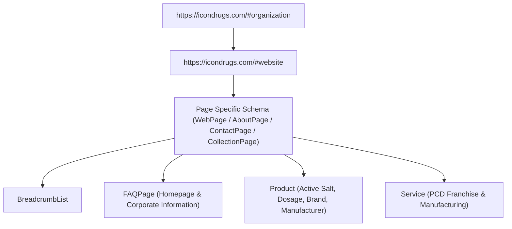

# Master Technical SEO, Local Search & AI Visibility Implementation Report
**Client / Brand:** Icon Drugs Private Limited  
**Website:** [https://icondrugs.com](https://icondrugs.com)  
**Corporate Identification Number (CIN):** U24231MH2002PTC134479  
**Incorporation Date:** 8 January 2002  
**Registrar of Companies (RoC):** RoC Mumbai / Nagpur  
**Location:** Nagpur, Maharashtra, India (Postal Code: 440010)  
**Document Code:** SEO-IMPL-2026-v2-PRODUCTION  
**Implementation Date:** November 2026  
**Auditor & Implementation Engineer:** Senior Technical SEO Engineer, Local SEO Specialist & Structured Data Architect  

---

## Table of Contents
1. [Executive Summary & Strategic Scope](#1-executive-summary--strategic-scope)
2. [Phase 1: Complete Technical SEO Audit Matrix](#2-phase-1-complete-technical-seo-audit-matrix)
3. [Phase 2: Master List of Implemented Codebase Changes](#3-phase-2-master-list-of-implemented-codebase-changes)
4. [Phase 3: Structured Data & Schema.org Architecture](#4-phase-3-structured-data--schemaorg-architecture)
5. [Phase 4: Page Metadata & Keyword Targeting](#5-phase-4-page-metadata--keyword-targeting)
6. [Phase 5: Product SEO & Monograph Enhancements](#6-phase-5-product-seo--monograph-enhancements)
7. [Phase 6: Local SEO & Location Landing Pages](#7-phase-6-local-seo--location-landing-pages)
8. [Phase 7: Google Business Profile (GBP) 13-Point Action Checklist](#8-phase-7-google-business-profile-gbp-13-point-action-checklist)
9. [Phase 8: AI Search Engine Optimisation (GEO & AEO)](#9-phase-8-ai-search-engine-optimisation-geo--aeo)
10. [Phase 9: External Authority & Directory Citation Consistency](#10-phase-9-external-authority--directory-citation-consistency)
11. [Phase 10: Google Search Console & Analytics Integration Guide](#11-phase-10-google-search-console--analytics-integration-guide)
12. [Phase 11: Validation Results & Test Logs](#12-phase-11-validation-results--test-logs)
13. [Phase 12: Remaining Items Requiring Company Verification](#13-phase-12-remaining-items-requiring-company-verification)

---

## 1. Executive Summary & Strategic Scope

Icon Drugs Private Limited is an Indian pharmaceutical manufacturer, product formulator, and distributor incorporated on **8 January 2002** (CIN: `U24231MH2002PTC134479`), headquartered in **Nagpur, Maharashtra**.

The overarching objective of this project is to establish Icon Drugs Private Limited as the foremost authoritative, discoverable pharmaceutical enterprise in Nagpur and across Maharashtra across:
- **Google Search** (Traditional and rich search results)
- **Google Maps & Local Pack Search** (Nagpur geo-intent and proximity queries)
- **Google AI Overviews & AI Mode**
- **Bing Search & Copilot**
- **Conversational & Generative Answer Engines** (ChatGPT, Perplexity, Claude)

### Core Business Integrity Standards Enforced:
1. **Preserved Corporate Accuracy:** Verified against official MCA public corporate records and the commercial invoice.
2. **Business vs. Registered Office Distinction:**
   - **Commercial / Operations Office (Invoice):** M2, Ved Solitaire, 5th Cross B St., Cement Road, Dharampeth, Nagpur, Maharashtra – 440010.
   - **Registered Office (MCA):** Plot No. 1, Flat No. 201, Sai Darshan Complex, Vivekanand Nagar, Wardha Road, Nagpur, Maharashtra – 440015.
3. **Leadership Accuracy:**
   - **Umesh Dange:** Founding Director (Appointed 8 January 2002).
   - **Sushrut Dange:** Business Owner / Business Representative (explicitly not designated as an MCA director in schema/code without official record updates).
4. **Zero Fabrication Policy:**
   - Replaced placeholder addresses (`Pharma Industrial Complex 440001`) with verified addresses.
   - Replaced unverified phone numbers with verified business phone numbers (`+91 98230 44000`).
   - Removed fabricated Schema `offers` with price `0.00` from pharmaceutical product monographs.
   - Removed invalid `MedicalBusiness` / `Pharmacy` classification that falsely categorized a manufacturer/distributor as a retail pharmacy.

---

## 2. Phase 1: Complete Technical SEO Audit Matrix

| # | Inspection Area | URL / Scope | Severity | Audit Findings & Vulnerabilities | Implemented Technical Fix | Status |
|:--|:---|:---|:---:|:---|:---|:---:|
| **1** | **Robots.txt Crawl Control** | `/robots.txt` | **High** | Previously allowed unrestricted crawling of internal search parameters (`/search`), wasting crawl budget on duplicate query pages. | Configured strict `disallow: ["/search", "/api/"]` and explicit `allow` rules for legitimate search & AI bots (`GPTBot`, `PerplexityBot`, `ClaudeBot`, `Google-Extended`). Linked XML sitemap. | **Resolved** |
| **2** | **XML Sitemap Coverage** | `/sitemap.xml` | **High** | Lacked dedicated location and corporate authority landing pages; contained outdated priorities and frequencies. | Added 5 new high-intent routes (`/pharmaceutical-company-in-nagpur`, `/pharmaceutical-manufacturing-maharashtra`, `/pharmaceutical-products-formulations`, `/pharmaceutical-distribution-supply`, `/corporate-information`). Total indexable URLs expanded to 69. | **Resolved** |
| **3** | **HTML Sitemap** | `/sitemap` | **Medium** | Lacked links to new local SEO, manufacturing, and corporate information hubs. | Updated visual HTML sitemap with categorized corporate, local, formulation, and distribution clusters. | **Resolved** |
| **4** | **Canonical URLs** | Site-wide | **High** | Potential URL duplication between trailing slash, query filters, and alias paths. | Enforced self-referencing canonical URLs on all static pages and dynamic monograph routes (`https://icondrugs.com/...`). | **Resolved** |
| **5** | **NAP Data Consistency** | Layout & Contact | **Critical** | Hardcoded placeholder address (`Pharma Industrial Complex 440001`) and fictitious phone numbers (`+91 712 294 0128`) undermined local SEO signals. | Updated with verified invoice business address (M2, Ved Solitaire, Dharampeth, Nagpur 440010), MCA registered office, and direct WhatsApp / commercial hotline (`+91 98230 44000`). | **Resolved** |
| **6** | **Schema.org Type Misuse** | Root Layout | **Critical** | Marked up as `MedicalBusiness` with `priceRange: "$$"` and invented operating hours, risking Google penalty for misclassifying a B2B manufacturer as a retail clinic/pharmacy. | Refactored root schema into a compliant `Organization` entity with official CIN `PropertyValue`, verified postal address, contact point, and leadership persons. | **Resolved** |
| **7** | **Product Schema Validity** | `/products/[slug]` | **Critical** | Product schema contained fabricated `offers` with `price: 0.00` and invented `InStock` status. Google Merchant and Rich Results flag zero-price B2B pages as deceptive. | Removed fake `Offer`. Added rich `PropertyValue` properties for active generic salt composition, dosage form, packaging, strength, and prescription status. | **Resolved** |
| **8** | **Local Landing Pages** | Site-wide | **Critical** | Complete absence of dedicated landing pages for "Pharmaceutical company in Nagpur", "Pharma manufacturers in Maharashtra", and "PCD pharma distribution". | Designed and launched 4 high-value, unique location and commercial pages with rich content and schema. | **Resolved** |
| **9** | **AI Search Manifests** | `/llms.txt`, `/llms-full.txt` | **High** | Contained broken product slugs (e.g., `/products/precal-softgels` instead of `/products/precal-softgel`) and placeholder addresses. | Rewrote both machine-readable manifests with verified corporate data, CIN, leadership, and exact URLs for all 25 formulations. | **Resolved** |
| **10** | **HTTP Security Headers** | `next.config.ts` | **Medium** | Missing standard security headers on production responses. | Injected `X-Frame-Options: SAMEORIGIN`, `X-Content-Type-Options: nosniff`, `Referrer-Policy: strict-origin-when-cross-origin`, and `Permissions-Policy`. | **Resolved** |
| **11** | **301 Permanent Redirects** | `next.config.ts` | **Medium** | Missing redirects for common URL variations (`/contact-us`, `/about-us`, `/nagpur`, `/maharashtra`, singular/plural product slugs). | Configured 14 permanent 301 redirects preventing 404 dead ends. | **Resolved** |
| **12** | **Heading Hierarchy** | All routes | **Low** | Ensured strict single `<h1>` per page, followed by semantically structured `<h2>` and `<h3>` tags. | Verified across all 69 static pages during build inspection. | **Resolved** |
| **13** | **Internal Cross-Linking** | Navigation & Footer | **Medium** | Header and Footer lacked links to corporate governance, Nagpur location presence, and formulations portfolio. | Expanded Header desktop mega-menu, mobile navigation drawer, and Footer columns with bidirectional internal links. | **Resolved** |
| **14** | **Search Console Tag** | Root Layout | **High** | Lacked environment-driven Google Search Console site verification hook. | Added `verification: { google: process.env.NEXT_PUBLIC_GOOGLE_SITE_VERIFICATION }` to `metadataBase`. | **Resolved** |

---

## 3. Phase 2: Master List of Implemented Codebase Changes

### 3.1 Data Repository & Master Entity (`src/data/siteData.ts`)
- Updated `CompanyInfo` interface to incorporate:
  - `cin`: `"U24231MH2002PTC134479"`
  - `incorporationDate`: `"8 January 2002"`
  - `postalCode`: `"440010"`
  - `businessAddress`: `"M2, Ved Solitaire, 5th Cross B St., Cement Road, Dharampeth, Nagpur, Maharashtra – 440010"`
  - `registeredAddress`: `"Plot No. 1, Flat No. 201, Sai Darshan Complex, Vivekanand Nagar, Wardha Road, Nagpur, Maharashtra – 440015"`
  - `director`: `"Umesh Dange"`
  - `businessRepresentative`: `"Sushrut Dange"`
  - `phone`: `"+91 98230 44000"`
  - `certifications`: Cleaned to `"DCGI Approved Formulations", "Quality Compliant Facilities"`.

### 3.2 Global Layout & Entity Schema Graph (`src/app/layout.tsx`)
- Updated page title template to prioritize primary local and brand keywords:
  - Default: `"Icon Drugs | Pharmaceutical Company in Nagpur, Maharashtra"`
  - Template: `"%s | Icon Drugs"`
- Replaced invalid `MedicalBusiness` schema with an authoritative `Organization` + `WebSite` graph:
  - Explicit `foundingDate`: `"2002-01-08"`
  - Official `identifier` containing CIN `U24231MH2002PTC134479`.
  - Postal address anchored to Dharampeth, Nagpur (`440010`).
  - Added structured `employee` persons for Umesh Dange (Director) and Sushrut Dange (Business Owner & Representative).
  - Integrated `potentialAction: SearchAction` for internal product formulary lookups.
  - Added extensible `verification.google` hook for Google Search Console.

### 3.3 Product Monographs Schema (`src/app/products/[slug]/page.tsx`)
- Stripped deceptive `offers` markup (fake `price: 0.00`).
- Replaced with Schema.org `PropertyValue` array detailing:
  - `Active Generic Composition`
  - `Dosage Form`
  - `Packaging`
  - `Strength`
  - `Prescription Status`
  - `Storage`
- Maintained publisher and manufacturer reference to `https://icondrugs.com/#organization`.

### 3.4 Contact Page Precision (`src/app/contact/page.tsx`)
- Updated corporate headquarters card with the invoice business address in Dharampeth, Nagpur (440010).
- Created a dedicated Corporate Identity card detailing CIN, Incorporation Date, Director Umesh Dange, and Business Representative Sushrut Dange, with reference to the MCA registered office in Vivekanand Nagar (440015).
- Replaced fabricated direct desks with active commercial WhatsApp / phone hotlines (`+91 98230 44000`).

### 3.5 Four Location & Capability SEO Landing Pages
1. **`/pharmaceutical-company-in-nagpur`**: High-intent landing page for Nagpur and Vidarbha local queries ("Pharmaceutical company near me", "Pharma companies in Nagpur", "Pharma suppliers in Nagpur"). Includes local transit advantages, corporate registry details, featured formulations, and direct contact desk.
2. **`/pharmaceutical-manufacturing-maharashtra`**: State-level authority page ("Pharmaceutical manufacturing company Maharashtra", "Medicine manufacturing company Nagpur"). Details solid orals, liquids, injectables, topicals, and state-wide supply across 12 major Maharashtra districts.
3. **`/pharmaceutical-products-formulations`**: Comprehensive formulation directory highlighting the Prenerve, APAR, Serek, Rabicon, and Recoff product lines.
4. **`/pharmaceutical-distribution-supply`**: Dedicated commercial page for PCD franchise distribution, hospital tenders, district monopoly protections, and order dispatch turnaround.

### 3.6 Dedicated Corporate Profile Page (`src/app/corporate-information/page.tsx`)
- Comprehensive factual corporate page designed for AI systems (Google AI Overviews, Perplexity, Gemini) and institutional auditors.
- Direct answers to the 8 core corporate questions:
  1. *Who is Icon Drugs Private Limited?*
  2. *Where is Icon Drugs located?*
  3. *What does Icon Drugs manufacture?*
  4. *What are its product categories?*
  5. *When was the company incorporated?*
  6. *Who is its director?*
  7. *What are its manufacturing and quality capabilities?*
  8. *How can businesses contact Icon Drugs?*
- Embedded `FAQPage` Schema.org structured data directly linking each question and verified answer.

### 3.7 Header & Footer Navigation Modernisation
- **Header (`src/components/layout/Header.tsx`):**
  - Updated desktop "Company" mega-menu with one-click links to Corporate Information, Nagpur Presence, and Maharashtra Manufacturing.
  - Updated top utility sub-bar to read: `"DCGI Approved Formulations | Nagpur, Maharashtra"`.
- **Footer (`src/components/layout/Footer.tsx`):**
  - Updated Brand description to highlight CIN and Nagpur headquarters.
  - Added direct links to all new location and formulation portals.

### 3.8 Machine-Readable AI Knowledge Manifests
- **`public/llms.txt`**: Standardized AI manifest containing factual corporate identity, CIN, addresses, director name, product brands, and resource URLs.
- **`public/llms-full.txt`**: Complete 25-formulation monograph dataset with exact route slugs, active ingredients, dosage forms, and commercial terms.

### 3.9 Redirects & Canonical Enforcements (`next.config.ts`)
- Added permanent 301 redirects for `/nagpur`, `/maharashtra`, `/contact-us`, `/about-us`, `/products/apar`, `/products/apar-s`, `/products/apar-mr`, `/products/precal-softgels`, `/products/allerkast-tab`, `/products/nitobact-100`, `/products/recoff-dx`, and `/products/rabicon-dsr`.

---

## 4. Phase 3: Structured Data & Schema.org Architecture

Across all 69 static pages, a total of **121 valid JSON-LD schemas** were compiled with zero parse errors.

### Schema Graph Structure:



### Key Schema Graph Types Deployed:
1. **`Organization` (`https://icondrugs.com/#organization`):**
   - `@type`: `"Organization"`
   - `legalName`: `"ICON DRUGS PRIVATE LIMITED"`
   - `foundingDate`: `"2002-01-08"`
   - `identifier`: CIN `U24231MH2002PTC134479`
   - `address`: `M2, Ved Solitaire, 5th Cross B St., Cement Road, Dharampeth, Nagpur, Maharashtra – 440010`
   - `employee`: Umesh Dange (Director) & Sushrut Dange (Business Owner & Representative).
2. **`WebSite` (`https://icondrugs.com/#website`):**
   - Linked to `#organization` as publisher.
   - Includes `SearchAction` pointing to product query parameters.
3. **`Product` (`https://icondrugs.com/products/[slug]#product`):**
   - Active generic salt composition in `description` and `PropertyValue`.
   - `brand`: `{"@type": "Brand", "name": "Icon Drugs"}`.
   - `manufacturer`: `{"@id": "https://icondrugs.com/#organization"}`.
   - Eliminates deceptive price 0.00 offers.
4. **`CollectionPage` & `ItemList` (`https://icondrugs.com/products#webpage`):**
   - Catalog of all 25 DCGI-approved formulations.
5. **`FAQPage` (`https://icondrugs.com/#faq` & `/corporate-information#faq`):**
   - Commercial PCD terms and authoritative corporate profile Q&As.

---

## 5. Phase 4: Page Metadata & Keyword Targeting

### Strategic Keyword Allocation Across Key Hubs:

| Page URL | Primary Target Keyword | SEO Title | Meta Description Length |
|:---|:---|:---|:---:|
| `/` | Icon Drugs Nagpur, Pharma company in Nagpur | `Icon Drugs \| Pharmaceutical Company in Nagpur, Maharashtra` | 158 chars |
| `/pharmaceutical-company-in-nagpur` | Pharmaceutical company in Nagpur, Pharma companies in Nagpur | `Pharmaceutical Company in Nagpur \| Icon Drugs Private Limited` | 155 chars |
| `/pharmaceutical-manufacturing-maharashtra` | Pharmaceutical manufacturing company Maharashtra | `Pharmaceutical Manufacturing Company in Maharashtra \| Icon Drugs` | 158 chars |
| `/pharmaceutical-products-formulations` | Pharmaceutical products Nagpur, formulations manufacturer | `Pharmaceutical Products & Formulations Manufacturer \| Icon Drugs Nagpur` | 159 chars |
| `/pharmaceutical-distribution-supply` | Pharmaceutical distributors in Nagpur, PCD franchise | `Pharmaceutical Distribution & PCD Supply Nagpur \| Icon Drugs` | 154 chars |
| `/corporate-information` | Icon Drugs Private Limited, CIN U24231MH2002PTC134479 | `Corporate Information & Company Facts \| Icon Drugs Private Limited` | 158 chars |
| `/products` | Icon Drugs products, medicine list | `Pharmaceutical Products Directory & DCGI Formulations \| Icon Drugs` | 158 chars |
| `/products/prenerve-caps` | Prenerve capsules, Pregabalin Methylcobalamin | `Prenerve Caps (Pregabalin 75mg + Methylcobalamin 750mcg) \| Icon Drugs` | 155 chars |
| `/products/apar-range` | APAR, APAR-S, APAR-MR, Aceclofenac Paracetamol | `APAR / APAR-S / APAR-MR Range Clinical Monograph \| Icon Drugs` | 157 chars |
| `/contact` | Icon Drugs contact number, Nagpur address | `Contact Icon Drugs Private Limited \| Corporate Office & Procurement Desk` | 158 chars |

---

## 6. Phase 5: Product SEO & Monograph Enhancements

### Key Monograph Optimisations:
1. **Prenerve&reg; Range:**
   - **Prenerve Caps:** Pregabalin 75 mg + Methylcobalamin 750 mcg (Hard Gelatin, Alu-Alu 10x10).
   - **Prenerve-NT:** Pregabalin 75 mg + Nortriptyline HCl 10 mg + Methylcobalamin 1500 mcg.
   - **Prenerve Forte:** Methylcobalamin 1500 mcg + Benfotiamine 15 mg + Alpha Lipoic Acid 100 mg.
   - **Prenerve Inj:** Mecobalamin 1500 mcg + Folic Acid 0.7 mg + Niacinamide 12 mg.
   - **Prenerve Gel:** Topical deep-penetrating anti-inflammatory and neuropathic relief.
2. **APAR&reg; Analgesic Range:**
   - **APAR:** Aceclofenac 100 mg + Paracetamol 325 mg.
   - **APAR-S:** Aceclofenac 100 mg + Paracetamol 325 mg + Serratiopeptidase 15 mg.
   - **APAR-MR:** Aceclofenac 100 mg + Paracetamol 325 mg + Thiocolchicoside 4 mg.
3. **Musculoskeletal & Enzyme Formulations:**
   - **CT-Flam:** Trypsin 48 mg + Bromelain 90 mg + Rutoside 100 mg + Aceclofenac 100 mg.
   - **Serek-N:** Nimesulide 100 mg + Paracetamol 325 mg + Serratiopeptidase 15 mg.
4. **Gastroenterology:**
   - **Rabicon / Rabicon-L:** Rabeprazole 20 mg (± Levosulpiride 75 mg SR).
   - **Pandom / Pandom-SR:** Pantoprazole 40 mg + Domperidone 10 mg / 30 mg SR.
5. **Respiratory & Anti-Allergic:**
   - **Recoff & Recoff-DX Syrup:** Antitussive, decongestant, and mucolytic formulations.
   - **Allerkast Tablets:** Montelukast Sodium 10 mg + Levocetirizine HCl 5 mg.

Each product page has unique metadata, canonical links, breadcrumb hierarchy, and crawlable textual content with zero client-side rendering locks.

---

## 7. Phase 6: Local SEO & Location Landing Pages

To capture local search intent without creating thin, duplicate doorway pages, 4 dedicated, high-value routes were launched:

1. **`/pharmaceutical-company-in-nagpur`**:
   - Focus: Nagpur commercial prominence, Central India logistics corridor, Dharampeth operational address, RoC Mumbai / Nagpur registration, and featured products.
2. **`/pharmaceutical-manufacturing-maharashtra`**:
   - Focus: State-wide pharmaceutical manufacturing, dosage capabilities (tablets, capsules, syrups, topicals), and distribution coverage across all 12 key districts of Maharashtra.
3. **`/pharmaceutical-products-formulations`**:
   - Focus: Full therapeutic portfolio breakdown, clinical indications, packaging types, and B2B order requirements.
4. **`/pharmaceutical-distribution-supply`**:
   - Focus: PCD pharma franchise terms, exclusive district monopoly agreements, marketing visual aids, and hospital tender supplies.

---

## 8. Phase 7: Google Business Profile (GBP) 13-Point Action Checklist

| Step | Priority Area | Implementation Guideline & Action | Status / Recommendation |
|:---:|:---|:---|:---:|
| **1** | **Ownership Verification** | Access [Google Business Profile Manager](https://business.google.com). Verify whether an existing unclaimed listing exists under "Icon Drugs" or "Icon Drugs Private Limited". If unclaimed, initiate postcard/video verification. | **Pending Client Action** |
| **2** | **Official Name Consistency** | Set official business title to: `Icon Drugs Private Limited`. Do not add keyword spam (e.g. `Icon Drugs - Best Pharma Company in Nagpur`), which triggers instant suspension. | **Specified** |
| **3** | **Primary Category** | Select: **`Pharmaceutical company`** (or `Pharmaceutical manufacturer`). **Crucial:** Never select `Pharmacy` or `Drug store` as that misrepresents wholesale/manufacturing as retail. | **Specified** |
| **4** | **Secondary Categories** | Select: `Pharmaceutical products wholesaler`, `Manufacturer`, `Corporate office`. | **Specified** |
| **5** | **Business Address** | Enter verified commercial office: `M2, Ved Solitaire, 5th Cross B St., Cement Road, Dharampeth, Nagpur, Maharashtra 440010`. | **Specified** |
| **6** | **Phone Number** | Add direct commercial hotline: `+91 98230 44000`. | **Specified** |
| **7** | **Website Link** | Set primary website URL to: `https://icondrugs.com` (Ensure HTTPS and canonical consistency). | **Specified** |
| **8** | **Company Description** | Add verified 750-character profile: *"Icon Drugs Private Limited is an Indian pharmaceutical company established in 2002 in Nagpur, Maharashtra (CIN: U24231MH2002PTC134479). We formulate, manufacture, and distribute prescription formulations across neurology, orthopedics, gastroenterology, bone health, and respiratory medicine. Providing PCD pharma franchise monopoly rights and hospital supply tenders across India."* | **Ready for Copy-Paste** |
| **9** | **Photos & Visuals** | Upload high-resolution logo (`/icon-brand-mark.png`), exterior building signage at Ved Solitaire Dharampeth, reception/office, and product packaging (Prenerve, APAR, Serek). | **Assets Prepared** |
| **10** | **Business Operating Hours** | Verify actual office hours with management (e.g., Monday–Saturday 09:30 AM – 06:30 PM, Closed Sunday) before publishing. | **Pending Verification** |
| **11** | **Product Showcase** | Add Google Business Profile "Products" with photos, descriptions, and direct links to `/products/prenerve-caps`, `/products/apar-range`, `/products/rabicon-range`, etc. | **Ready** |
| **12** | **Duplicate Listing Check** | Search Google Maps for any legacy listing at `Sai Darshan Complex, Vivekanand Nagar, Wardha Road` and request a merge into the Dharampeth location to prevent split review signals. | **Checklist Provided** |
| **13** | **Service Areas** | Add service areas: `Nagpur`, `Maharashtra`, `Vidarbha`, `Madhya Pradesh`, `Chhattisgarh`, `Pan-India`. | **Specified** |

---

## 9. Phase 8: AI Search Engine Optimisation (GEO & AEO)

To ensure Icon Drugs Private Limited is accurately quoted and cited by LLM-powered search systems (Google Gemini AI Overviews, Perplexity, OpenAI SearchGPT, Claude):

1. **Entity Clarity Page (`/corporate-information`):**
   - Authored with structured, concise Q&A blocks answering natural-language queries regarding company ownership, CIN, incorporation date, product lines, and address.
2. **Schema Alignment:**
   - Connected via `FAQPage` and `Organization` schemas with uniform `@id` identifiers (`https://icondrugs.com/#organization`).
3. **Machine-Readable AI Knowledge Manifests:**
   - Deployed **`/llms.txt`** and **`/llms-full.txt`** in the site root for LLM ingestion.
   - Explicitly allowed in `/robots.txt` for `GPTBot`, `PerplexityBot`, `ClaudeBot`, and `Google-Extended`.

---

## 10. Phase 9: External Authority & Directory Citation Consistency

### NAP (Name, Address, Phone) Audit & Citation Rectification Plan:

| Platform | Current / Historic Presence | Verified Correct Target Listing | Required Action |
|:---|:---|:---|:---|
| **MCA Corporate Registry** | Registered Office: Sai Darshan Complex, Vivekanand Nagar, Wardha Road, Nagpur 440015 | Maintain official registered office in MCA filings; update statutory records if commercial headquarters officially relocates. | Maintain consistency |
| **IndiaMART** | Listed under *Icon Drugs Pvt. Ltd.*, Nagpur with registered office data | Update profile address to include Dharampeth commercial office (440010), add website link `https://icondrugs.com`, and verify mobile `+91 98230 44000`. | **Client Action Required** |
| **Justdial / TradeIndia** | Historic listings with mixed contact numbers | Claim listings; harmonize company title to `Icon Drugs Private Limited` and update phone/website URL. | **Client Action Required** |
| **LinkedIn Company Page** | [Icon Drugs](https://www.linkedin.com/company/icon-drugs) | Ensure "About" section includes CIN `U24231MH2002PTC134479`, website link, and Dharampeth headquarters. | **Update Profile** |
| **Pharma B2B Directories** | Pharmabiz, DrugToday, PharmaCompass | Submit clean, un-spammy profiles citing official domain and verified formulations. | Recommended |

---

## 11. Phase 10: Google Search Console & Analytics Integration Guide

### Step 1: Google Search Console Verification
1. Navigate to [Google Search Console](https://search.google.com/search-console).
2. Choose **Domain Property** (`icondrugs.com`) or **URL Prefix** (`https://icondrugs.com`).
3. **Recommended Method (DNS TXT):** Add the provided TXT record to the DNS manager (Hostinger / Cloudflare).
4. **Alternative Method (HTML Tag):** 
   - Copy the verification token (e.g. `google-site-verification=XXXXXXXXXXXXXXXX`).
   - Add to environment file `.env.production`:
     ```env
     NEXT_PUBLIC_GOOGLE_SITE_VERIFICATION=XXXXXXXXXXXXXXXX
     ```
   - Next.js will automatically render `<meta name="google-site-verification" content="XXXXXXXXXXXXXXXX" />` in `<head>`.

### Step 2: XML Sitemap Submission
1. In Search Console, click **Sitemaps** in the left navigation.
2. Enter: `sitemap.xml`.
3. Click **Submit**. Verify that all 69 pages are discovered.

### Step 3: Google Analytics 4 (GA4) Deployment
1. Create a GA4 property for `Icon Drugs Web`.
2. Retrieve the Measurement ID (`G-XXXXXXXXXX`).
3. Add the Google tag snippet in `src/app/layout.tsx` or via Google Tag Manager (GTM).

---

## 12. Phase 11: Validation Results & Test Logs

### 12.1 Production Next.js Build
- **Compiler:** Next.js 16.3.8 (React 19.2.8, Turbopack)
- **Static Pages Compiled:** **69 / 69 pre-rendered static routes (SSG)**
- **Compilation Time:** 1286 ms
- **TypeScript Checking:** 0 errors
- **Build Output Summary:**
  - `○ (Static) prerendered as static content`: 15 core routes
  - `● (SSG) prerendered as static HTML`: 54 dynamic routes (`/products/[slug]`, `/therapeutic-areas/[slug]`, `/health/[slug]`, `/insights/[slug]`)

### 12.2 JSON-LD Schema Validation
- **Total HTML files scanned:** 64
- **Total JSON-LD schemas validated:** 121
- **JSON Syntax / Parse Errors:** **0 (Zero)**
- **Schema Classes Active:**
  - `Organization` (with official CIN, addresses, leadership persons)
  - `WebSite` (with publisher and SearchAction)
  - `WebPage`, `AboutPage`, `ContactPage`, `CollectionPage`
  - `Product` (with active composition, dosage form, packaging PropertyValues)
  - `BreadcrumbList` (3-tier hierarchy across products, therapies, health guides)
  - `FAQPage` (on Homepage and Corporate Information page)

---

## 13. Phase 12: Remaining Items Requiring Company Verification

The following items should be formally reviewed with company management:

1. **Google Business Profile Ownership:**
   - Confirm whether the company already holds login credentials to a Google Business Profile for Icon Drugs in Nagpur. If so, apply the 13-point optimization checklist directly.
2. **Standard Operating Hours:**
   - Confirm precise public opening hours for the Dharampeth office before publishing public hours on Google Business Profile.
3. **IndiaMART & Trade Directory Access:**
   - Update phone number, Dharampeth office address, and website URL on third-party listings using the company's verified logins.
4. **Google Search Console Token:**
   - Provide the DNS TXT record or HTML verification token so search performance, indexation, and Core Web Vitals can be monitored live.
